# TukMC

TukMC replaces the Minecraft HUD and chat with boxed panels. It adds a top bar with world information, new health, food and experience bars, potion timers, mob health bars and a chat with extra tools. Each part can be turned on or off in game.

This is a port of TukMC for Minecraft 1.6.4, made by Vazkii and maxpowa, to Minecraft modern versions (1.21.1 for now) for NeoForge and Fabric.

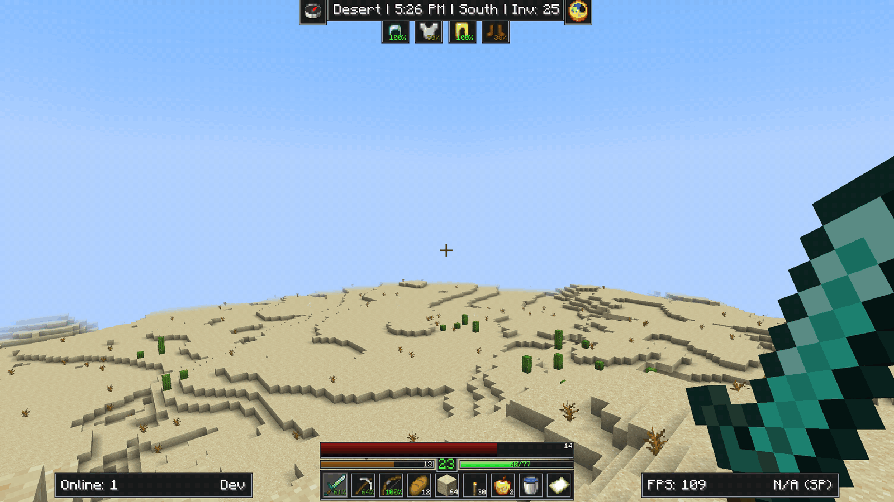

TukMC only runs on the client side. It works on any server.

## HUD

### Top bar

The top bar shows the biome, the time, the direction you are facing and how many inventory slots are free. A compass and a clock sit on each side. Your armor hangs under it, with the durability left on each piece. The time comes from your computer's clock, in 12 or 24 hour format.

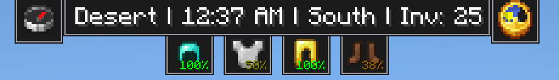

### Health, food, and experience

Health is the large red bar, with food and experience below it and your level in the middle. When you hold food, the food bar shows how much it will restore. If eating it now would waste some of it, the bar shows how much.

The alternate layout puts health and food side by side, with the level in a small box between them.

| Default | Alternate |
| --- | --- |
| 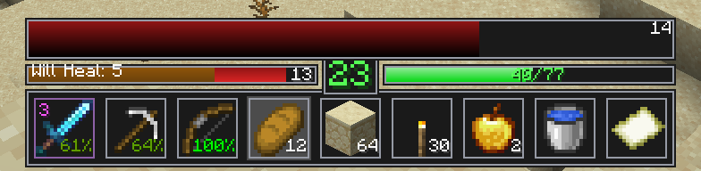 | 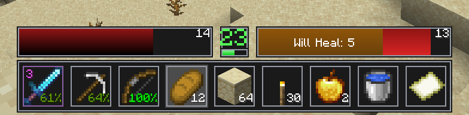 |

The bar color changes with effects such as poison, wither or regeneration. Riding a horse adds a thin bar for the horse's health, and an air bar appears when you are underwater. To get the vanilla hearts and drumsticks back, turn off "Custom Health/Food/XP Bars".

### Hotbar and side panels

Each hotbar slot shows how much durability the item has left. The left panel shows how many players are online, plus your name or what you are doing (sneaking, sprinting, flying, falling, or too hungry to sprint). The right panel shows your FPS and ping, or the time instead of the ping if you prefer.

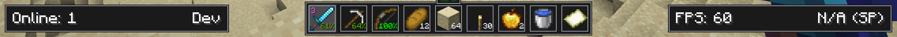

### Potion effects

Active effects are listed in the bottom right corner, each with its remaining time.

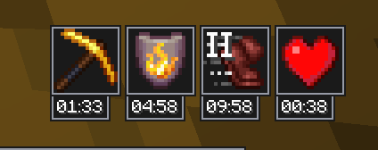

### Boss bar

Boss bar has a custom design!

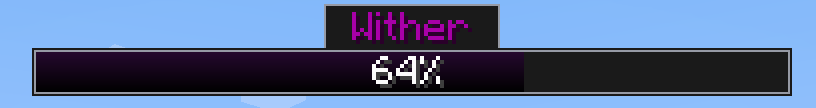

### Music

Music widget shows on the status bar while a music is playing from a jukebox.

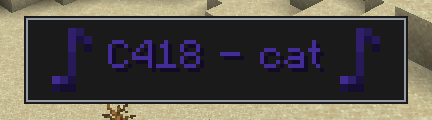

### Around the screen

The block you are looking at is shown in the top right corner, with its ID if you want it (can be disabled).

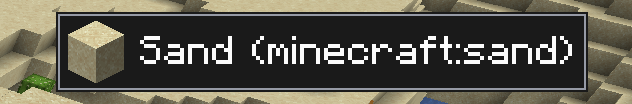

When you hold a bow or a crossbow, your arrow count appears above the crosshair. It turns red when you are running low.

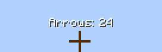

The Danger Zone box appears when the light where you stand is low enough for monsters to spawn.

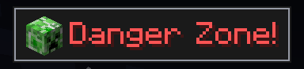

### Mob health bars

Mobs show a health bar above their head, with their current and max health.

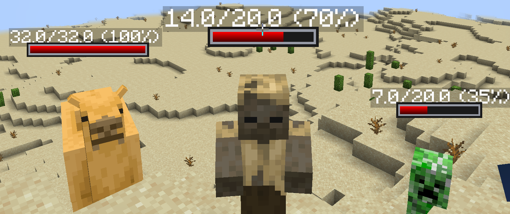

### Item tooltip

Hold the tooltip key (Delete by default) to see the details of the item in your hand. You can also make the tooltip pop up each time you switch items, or keep it on all the time.

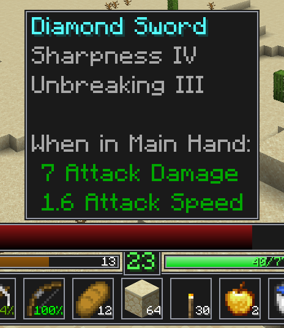

### Stats and scoreboard

The side stats board counts your deaths, mob kills and player kills since the last reset.

The scoreboard sidebar uses the same box style.

You can reset the stats from the Settings Menu.

| Stats board | Scoreboard |
| --- | --- |
| 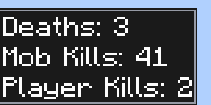 | 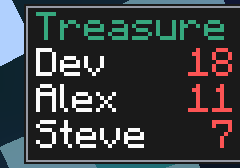 |

## Chat

The chat input sits above the messages, with a row of buttons next to it. Hover a button to see what it does.

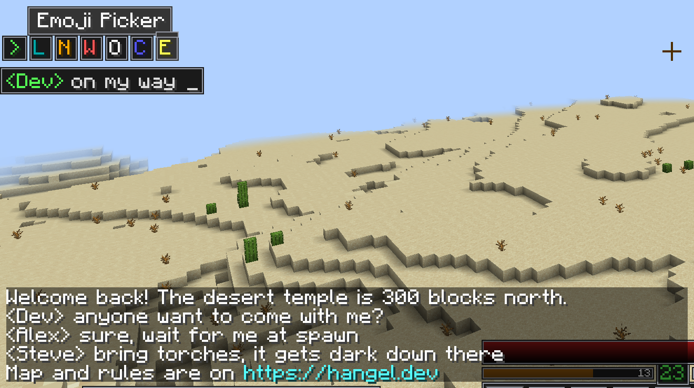

- **L** keeps the chat open after you send a message.
- **N** turns the notification sound for new messages on or off.
- **W** clears the chat.
- **O** saves the chat to a text file in `tukmc/chatlogs` when you click it while holding Shift. The message that confirms the save has a clickable file name.
- **C** opens the character picker.
- **E** opens the emoji picker.

Links in messages are highlighted. To see when a message was received, hover it while holding the tooltip key.

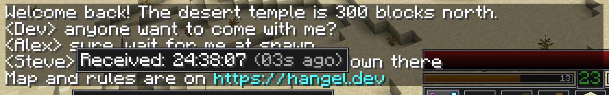

### Links

When you click a link, the confirmation screen tells you how many times you have opened that website before.

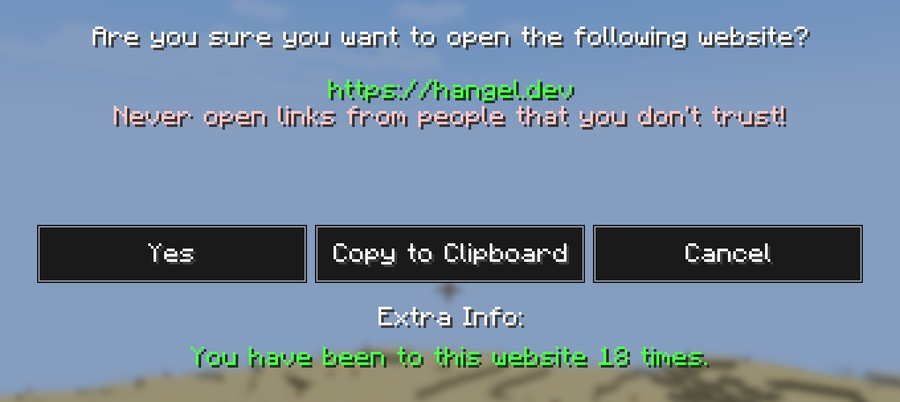

### Character and emoji pickers

The pickers list symbols you can't easily type. Select up to 12, then insert them into your message. The emoji list only contains emoji that the Minecraft font can draw.

| Emojis | Characters |
| --- | --- |
| 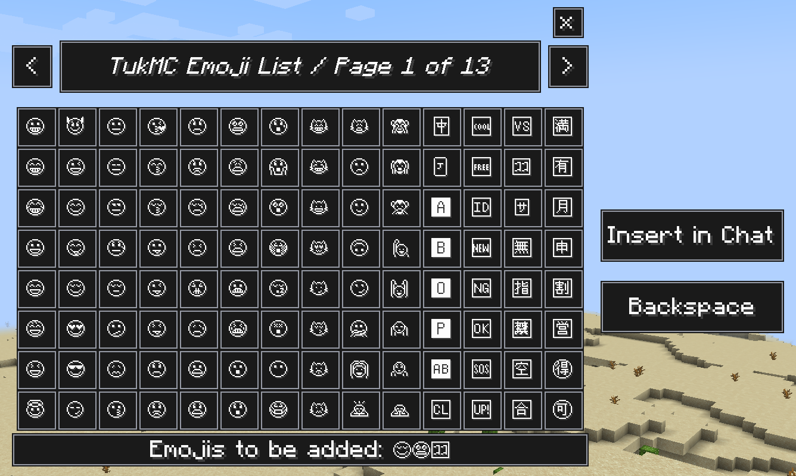 | 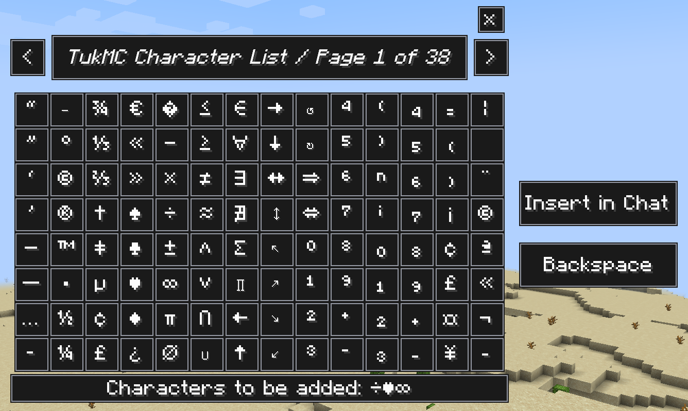 |

## Settings

Open the settings from the mod list. On NeoForge, go to Mods, TukMC, then Config. On Fabric, use Mod Menu. Each option has a toggle, and you can bring back the vanilla chat with "Use Default (Vanilla) Chat".

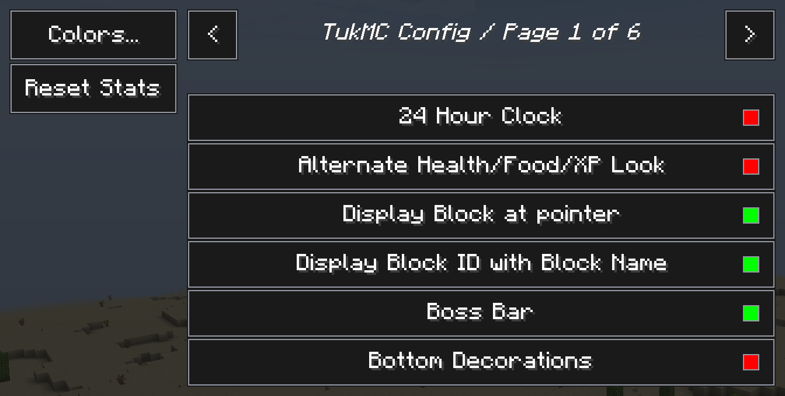

The Colors screen sets the fill and outline colors used by every box.

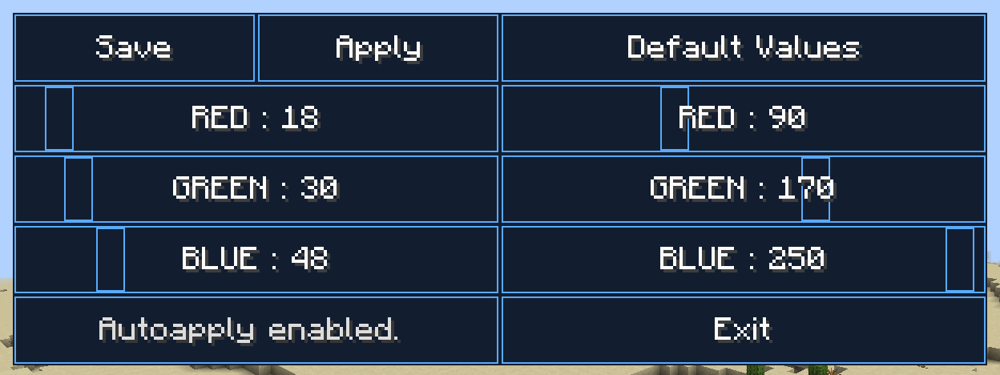

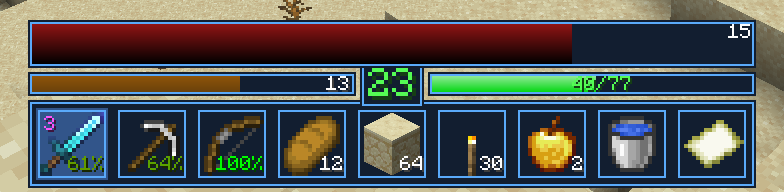

## Languages

TukMC is available in English, French, German, Spanish, Brazilian Portuguese, Russian, Simplified Chinese, Japanese, Polish, Italian, Arabic and Hindi.

## Credits

- Vazkii: the original author
- Maxpowa: Minecraft 1.6.4 port